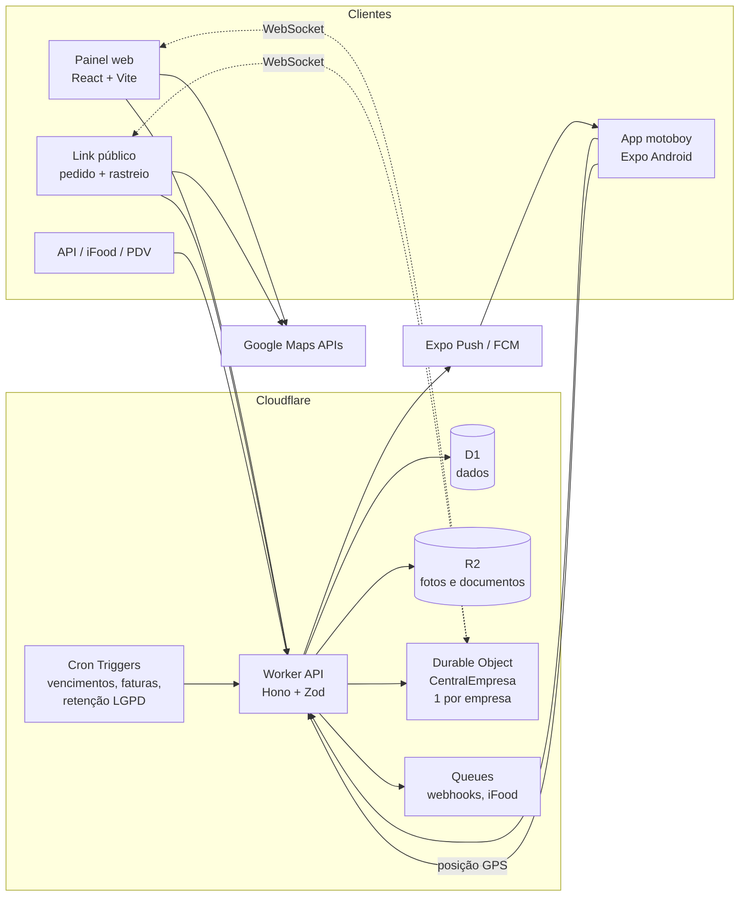
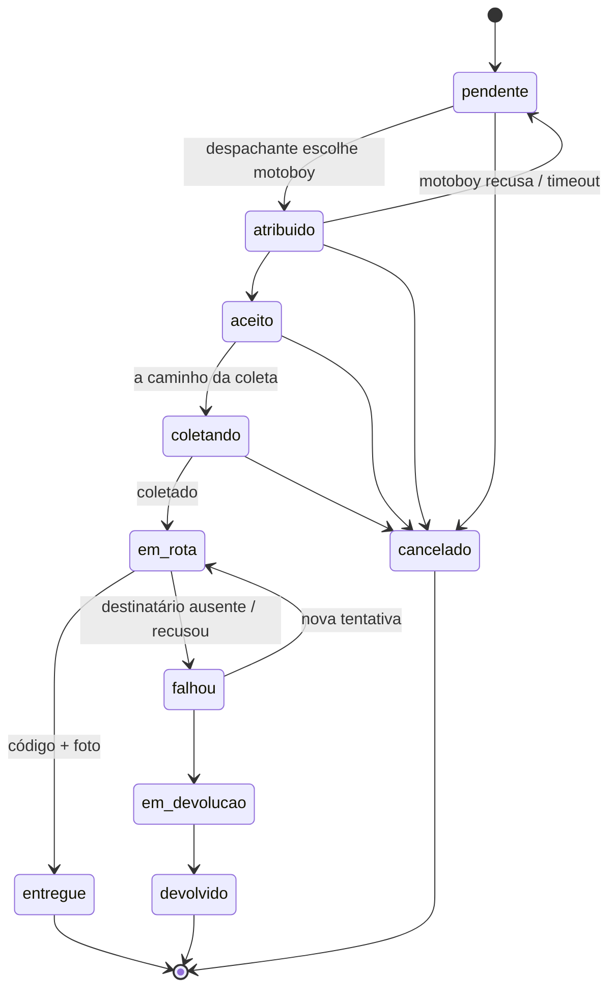

# Plataforma de Entregas — Pesquisa, Decisões e Arquitetura

Versão 0.1 · 07/11/2026 · Operação inicial: **Cascavel/PR**

---

## 1. Decisões tomadas

| Tema | Decisão |
|---|---|
| Tipos de empresa | **Os dois**: lojas com frota própria **e** empresas de motofrete (B2B, com clientes contratantes e tabela de frete) |
| Motoboy | **Um login, várias empresas** (vínculo por empresa) |
| App do motoboy | **Android nativo** (Expo / React Native) com GPS em segundo plano |
| Entrada de pedidos | Painel (atendente) · link público do cliente · API/webhooks · iFood/PDV |
| Modelo de receita | **Comissão por entrega**, configurável por empresa (fixo, % do frete ou ambos), fatura mensal |
| MVP obrigatório | Mapa ao vivo · link de rastreio via WhatsApp · comprovante (foto + código) · cobrança na entrega + acerto |
| Infraestrutura | **Cloudflare** (Workers, D1, Durable Objects, R2, Queues) |
| Mapas | **Google Maps** (Places, Geocoding, Routes, Maps JS) |
| WhatsApp | **Botão com mensagem pronta** (`wa.me`) no MVP; API oficial da Meta depois |
| Região | Interior do PR, começando por **Cascavel** |

---

## 2. Padrão de mercado (referências: Onfleet, Tookan, Shipday, Saipos Entregador)

1. **Três superfícies**: painel web do despachante, app do entregador, página de rastreio sem login para o cliente final.
2. **Máquina de estados do pedido** com histórico de eventos (quem, quando, onde) — base para auditoria, disputas e métricas.
3. **Despacho** manual e automático (mais próximo / menos carregado); roteirização multi-paradas.
4. **Comprovante de entrega (POD)**: foto, assinatura, código/PIN do destinatário.
5. **Rastreio em tempo real** com ETA para o cliente.
6. **Gestão de documentos do entregador** com alerta de vencimento.
7. **Multi-tenant em schema compartilhado** com `empresa_id` em toda tabela de dados da empresa, isolamento obrigatório na camada de dados.
8. **API-first** + webhooks para integrar PDVs e marketplaces.

---

## 3. Contexto regulatório (Brasil / Paraná / Cascavel)

> Não é parecer jurídico. Confirmar com advogado, contador e Transitar antes de operar.

### Motofrete — Lei 12.009/2009 + Resolução Contran 410/2012
- Condutor com **21+ anos**, **CNH categoria A há 2+ anos**, **curso especializado de 30h**, colete retrorrefletivo.
- Moto na **categoria aluguel (placa vermelha)**, baú/alforje regulamentado, inspeção periódica.
- A **MP 1.360/2026** flexibilizava essas regras, mas **perdeu a validade em 15/09/2026** — as exigências originais voltaram a valer.

### Municipal
- Cada município regula o motofrete (alvará/licença, cadastro do condutor). Curitiba: Lei 11.738/2006, URBS.
- **Cascavel: regra municipal ainda não localizada** → confirmar com o **Transitar**. Por isso o sistema terá **regras de documentos por cidade**, editáveis pelo super admin.

### Vínculo de trabalho
- PLP 12/2024 cobre apenas motoristas de passageiros e segue no Congresso; entregadores estão em discussão separada.
- O sistema **não fixa o tipo de vínculo**: cada vínculo motoboy↔empresa tem `tipo_vinculo` (CLT, MEI, freelancer).

### LGPD
- Localização do motoboy é dado pessoal → coletar **somente durante turno ativo**, com notificação permanente no Android ("Você está em turno — localização ativa").
- **Retenção limitada**: pontos de GPS brutos apagados após 90 dias (configurável); a rota resumida fica no pedido.
- **Papéis**: a empresa é **controladora** dos dados dos seus clientes; a plataforma é **operadora**. Termos de uso + contrato de tratamento de dados com cada empresa.
- Motoboy só vê dados do destinatário (nome, telefone, endereço) **das entregas atribuídas a ele e enquanto estiverem ativas**.
- Empresa A **nunca** vê posição do motoboy quando ele está em turno na empresa B.

---

## 4. Perfis de acesso

| Perfil | Onde | O que faz |
|---|---|---|
| Super admin | Painel plataforma | Cadastra empresas, contratos de comissão, faturas, regras por cidade |
| Admin da empresa | Painel web | Tudo da empresa: usuários, motoboys, frete, remuneração, acerto, integrações |
| Despachante | Painel web | Pedidos, despacho, mapa ao vivo, conferência do acerto |
| Motoboy | App Android | Turno, aceitar/executar entregas, cobrar, comprovar, fechar acerto |
| Cliente contratante | Portal web (empresas de motofrete) | Solicita coletas/entregas, vê histórico e fatura de frete |
| Destinatário | Link público | Acompanha a entrega, recebe o código de confirmação |

---

## 5. Arquitetura (Cloudflare)



### Componentes
- **Worker API (Hono + Zod)**: única porta de entrada. Autenticação, autorização por perfil e **escopo obrigatório de empresa**.
- **D1 (SQLite)**: banco único com `empresa_id` em todas as tabelas da empresa. D1 **não tem RLS**, então:
  - todo acesso passa por um repositório que exige o contexto `{ empresaId, usuarioId, papel }` e injeta o filtro;
  - consultas SQL soltas fora dessa camada são proibidas (regra de lint/revisão);
  - **testes automáticos de isolamento** tentam ler/escrever dados de outra empresa em cada rota.
- **Durable Object `CentralEmpresa`** (um por empresa): recebe posições dos motoboys em turno, guarda a última posição, transmite por WebSocket ao painel (mapa ao vivo) e ao link de rastreio (apenas o motoboy daquele pedido, apenas enquanto em rota). Usa WebSocket Hibernation para custo baixo.
  - Implementado na Fase 1, parte 3. O Worker continua gravando todos os pontos no D1; o DO recebe só o mais recente de cada envio (pontos atrasados da fila offline não voltam o marcador) e o apaga quando o turno encerra. Posição sem atualização há 12 h some do mapa.
  - Os avisos ao DO saem depois da resposta (`waitUntil`): se o tempo real falhar, a operação não falha; o painel se corrige ao reconectar e com uma consulta de segurança a cada 60 s.
  - WebSocket do painel exige sessão de admin/despachante e é bloqueado quando aberto por outro site (mesma regra de CSRF).
- **Link de rastreio**: `pedidos.token_rastreio` (128 bits aleatórios) guardado em claro, porque a central reenvia o link; dá só leitura do status daquele pedido. A resposta não traz nome nem telefone do destinatário; código, endereço e cobrança somem quando o pedido termina, e o link expira 48 h depois. A página é uma segunda entrada do build do painel (`apps/painel/rastreio.html`), leve (sem React Query, roteador nem zod; o mapa só baixa em rota) e servida pelo Worker em `/r/*`.
- **R2**: fotos de comprovante e documentos do motoboy (acesso por URL assinada de curta duração).
- **Queues**: entrega confiável de webhooks e processamento de eventos do iFood.
- **Cron Triggers / Alarms**: polling do iFood (via alarm de DO, intervalo de 30s), alerta de documentos vencendo, geração da fatura mensal de comissão, expurgo de GPS (LGPD, diário) e prazo de aceite dos pedidos (a cada minuto). As tarefas ficam em `apps/api/src/tarefas.ts`.
- **Auth** (implementada na Fase 0, sem biblioteca externa): senha com PBKDF2-SHA256 (100 mil iterações, máximo do runtime) via Web Crypto; sessões opacas guardadas como hash SHA-256 no D1, válidas por 30 dias com renovação diária. Painel usa cookie HttpOnly/Secure/SameSite=Lax; app do motoboy usa `Authorization: Bearer`. Login por e-mail, telefone ou CPF; bloqueio de 15 min após 5 falhas. Entrada na empresa só por convite (link de uso único, 7 dias, guardado como hash). Proteção CSRF por `Sec-Fetch-Site`/`Origin` + exigência de JSON.

### App do motoboy (Expo)
- `expo-location` + `expo-task-manager` com **foreground service** para GPS em segundo plano (envio a cada ~15s em rota, ~60s parado).
- Fila offline: posições ficam no aparelho e sobem quando a internet volta (comum em áreas sem sinal). As ações do pedido (coletar, entregar, falhar) ainda exigem conexão; a fila delas, com chave de idempotência, está na Fase 1.5.
- Navegação por **deep link** para Google Maps / Waze (sem custo de API).
- Push de nova entrega via Expo Push (FCM).
- Distribuição: Google Play (conta de desenvolvedor) ou APK direto na fase piloto.

### Google Maps
- **Provisório:** enquanto não há conta no Google Cloud, os mapas usam Leaflet + OpenStreetMap (`apps/painel/src/componentes/Mapa.tsx`). A política de uso dos servidores do OSM não comporta volume de produção; a troca para o Maps JavaScript fica toda nesse componente.
- **Places Autocomplete + Geocoding** no cadastro de endereços (painel e link público); CEP preenchido via BrasilAPI.
- **Maps JavaScript** no mapa ao vivo e no rastreio.
- **Routes API** para distância/tempo → frete por km e ETA.
- Chaves restritas por domínio/app e com limite de cota para evitar surpresa na fatura.

---

## 6. Ciclo de vida do pedido



- Pedido tem **paradas** (coleta → uma ou mais entregas), essencial para motofrete B2B; o status do pedido é derivado das paradas.
- Toda transição gera um **evento** com usuário, data/hora e coordenada GPS.
- Depois de `em_rota`, cancelamento vira **devolução** (o item já saiu).
- **Prazo de aceite** (opcional, por empresa, 1 a 60 min): gravado no pedido na atribuição (`pedidos.aceite_ate`); trocar de motoboy recomeça a contagem e qualquer outra mudança a encerra. Um cron a cada minuto devolve à fila os vencidos, com o evento `expirar_aceite` no nome do motoboy que não respondeu, e avisa o painel pelo `CentralEmpresa`. Ninguém executa essa ação pela API.

### Comprovante de entrega
- **Código de 4 dígitos** gerado por pedido, enviado ao destinatário junto com o link de rastreio. O motoboy digita para concluir; 5 erros bloqueiam a entrega pelo app e só a central confirma.
- **Entrega sem o código** (ex.: deixou na portaria): só pelo app, com foto e "com quem ou onde ficou". Fica bloqueada junto com o código e aparece destacada no painel.
- **Foto**: sempre obrigatória na falha e na entrega sem código; na entrega com código, opcional ou obrigatória conforme a empresa (Dados da empresa → Regras de entrega). Vale só a foto enviada depois da última mudança de status, então uma nova tentativa pede foto nova. A central registra pelo painel sem foto (o motoboy pode ter ligado).

---

## 7. Dinheiro

### Cobrança na entrega
- Formas: **dinheiro** (com "troco para"), **Pix** (QR/copia-e-cola da chave da empresa), **cartão** (maquininha), **já pago** (online/iFood).
- O motoboy registra o que recebeu; divergências ficam marcadas para o despachante.
- Fase posterior: Pix dinâmico com confirmação automática via PSP (Asaas, Efí, Mercado Pago).

### Acerto do motoboy (fechamento de turno)
```
dinheiro recebido − fundo de troco devolvido      = valor a repassar à empresa
remuneração (regra da empresa)                    = valor a receber pelo motoboy
saldo final = a repassar − a receber              (positivo: motoboy deve; negativo: empresa deve)
```
- Regras de remuneração por empresa (e exceção por motoboy): **valor por entrega**, **base + km**, **diária + por entrega**.
- Despachante confere e fecha; acerto fechado é imutável (ajustes viram lançamentos novos).

### Frete (empresas de motofrete)
- Tabela por empresa e por cliente contratante: **fixo**, **faixas de km** ou **base + km**, adicionais (espera, retorno, chuva/noturno).

### Comissão da plataforma
- Contrato por empresa: **valor fixo por entrega**, **% do frete**, ou ambos; opcional **mínimo mensal**.
- Conta apenas entregas `entregue` (configurável se `falhou`/`devolvido` contam).
- **Fatura mensal** gerada automaticamente; cobrança inicialmente manual (Pix/boleto). Emissão de NFS-e sobre a comissão: alinhar com contador (ISS de Cascavel).

---

## 8. Modelo de dados (principais tabelas)

| Tabela | Escopo | Campos-chave |
|---|---|---|
| `cidades` | global | nome, uf, `regras_documentos` (JSON) |
| `empresas` | global | tipo (`loja`/`motofrete`), cnpj, cidade_id, status, configurações |
| `usuarios` | global | nome, email, telefone, cpf, super_admin |
| `vinculos` | empresa | usuario_id, empresa_id, papel, tipo_vinculo, status |
| `motoboy_perfis` | global (do motoboy) | CNH (nº, categoria, validade, 1ª habilitação), placa, renavam, categoria aluguel |
| `documentos` | global (do motoboy) | tipo, arquivo R2, validade, status de verificação |
| `clientes` | empresa | tipo (`contratante`/`destinatario`), contato, endereços |
| `tabelas_frete` | empresa | cliente_id (opcional), modelo, valores |
| `pedidos` | empresa | origem (`painel`/`link`/`api`/`ifood`), status, motoboy_id, frete, valor a cobrar, forma de pagamento, troco, código de entrega, token de rastreio |
| `paradas` | empresa | pedido_id, ordem, tipo, endereço, lat/lng, status, foto, recebedor |
| `eventos_pedido` | empresa | pedido_id, de→para, usuario_id, lat/lng, data/hora |
| `turnos` | empresa | motoboy_id, início, fim |
| `posicoes` | empresa | turno_id, lat/lng, precisão, velocidade, data/hora (expurgo 90 dias) |
| `recebimentos` | empresa | pedido_id, forma, valor, troco |
| `regras_remuneracao` | empresa | motoboy_id (opcional), modelo, valores |
| `acertos` | empresa | motoboy_id, turno(s), totais, status, fechado_por |
| `contratos_comissao` | global | empresa_id, fixo, percentual, mínimo |
| `faturas_comissao` | global | empresa_id, mês, qtd entregas, valor, status |
| `integracoes` / `chaves_api` / `webhooks` | empresa | tipo, credenciais criptografadas, URL, segredo |

Regra adicional: **o motoboy só tem um turno ativo por vez** (escolhe a empresa ao iniciar). Simplifica o mapa ao vivo, o acerto e a privacidade.

---

## 9. Estrutura do repositório

```
entregas/
  apps/
    api/        Worker (Hono) + Durable Objects + migrations D1
    painel/     React + Vite (empresa, despachante, super admin, portal do contratante)
                + páginas públicas leves como entradas separadas do mesmo build
                (rastreio.html; o link público de pedido da Fase 3 vai pelo mesmo caminho),
                porque um Worker serve um único diretório de arquivos estáticos
    motoboy/    Expo (Android)
  packages/
    shared/     tipos, schemas Zod, máquina de estados, cálculo de frete/acerto/comissão
  docs/
```
Monorepo com **npm workspaces**; TypeScript em tudo; testes com Vitest (`@cloudflare/vitest-plugin` para a API). O painel é servido pelo mesmo Worker da API (Workers Static Assets), então painel e API ficam na mesma origem.

### Ambientes, CI e monitoramento
- **Três ambientes** no `wrangler.jsonc`: desenvolvimento (local), **homologação** (`entregas-homologacao`, com D1 e R2 próprios) e **produção**. Nada de teste com dado real.
- **GitHub Actions**: todo PR e push passa por lint, tipos, testes e build (`verificar.yml`). Push na `main` publica sozinho na homologação; produção é um botão manual (`producao.yml`), com aprovação opcional pelo ambiente `producao` do GitHub. Publicar = migrations do D1 → deploy do Worker → conferência de `/api/v1/saude`. Dependabot semanal (o SDK do Expo fica de fora: atualiza com `expo install --fix`).
- **Lint e formatação com Biome** (`biome.json`), com a regra de isolamento: em `apps/api/src`, tabelas com `empresa_id` só podem ser importadas por `src/dados` e `src/db`. LF em todos os arquivos (`.gitattributes`), igual no Windows e no CI.
- **Sentry** (opcional, ligado por DSN) na API, no Durable Object, no cron, no painel e no app (inclui travamentos nativos). Só erros, sem rastreamento de desempenho por enquanto. LGPD: sem corpo de requisição, cookies, usuário, IP, captura de tela nem tokens de rastreio/convite da URL (`packages/shared/src/privacidade.ts`, com testes). A página pública de rastreio fica sem Sentry para continuar leve.

---

## 10. Roteiro

| Fase | Entrega |
|---|---|
| **0 — Fundação** ✅ | Monorepo, Worker + D1, auth, camada multi-tenant com testes de isolamento, cadastro de empresas/usuários/vínculos, convites, painel (login, empresas, equipe, aceite de convite) |
| **1 — Núcleo** | **Parte 1 ✅** pedidos pelo painel, ciclo de status com histórico, despacho manual, código de entrega (bloqueia após 5 erros), cadastro de clientes pelo telefone, endereço da empresa como coleta padrão, CEP via ViaCEP. **Parte 2 ✅** app Android do motoboy em Expo (login, turno único por pessoa, GPS em segundo plano com aviso fixo e fila offline, entregas, código, foto no R2), retenção de GPS de 90 dias por cron. Pendente: teste em aparelho real e notificação push. **Parte 3 ✅** Durable Object `CentralEmpresa` com WebSocket Hibernation, mapa ao vivo no painel (posições e turnos em tempo real, fila de pedidos atualizada sozinha), link público de rastreio `/r/<token>` (status, código, mapa do entregador só em rota, expira 48 h após concluir) e link + código no botão do WhatsApp. Mapa provisório em Leaflet + OpenStreetMap até existir a chave do Google Maps. **Parte 4 ✅** regras de entrega por empresa: foto obrigatória na falha e na entrega sem código (e, se a empresa quiser, em toda entrega), entrega sem código com foto, prazo de aceite com volta automática à fila |
| **1.5 — Pronto para piloto** | **Parte 1 ✅** fundação de engenharia: Biome (lint + formatação + regra de isolamento), CI/CD no GitHub Actions, homologação com banco e fotos próprios, Sentry na API, painel e app, tela de erro no lugar de página em branco. **A seguir:** coordenadas em toda parada (geocodificação), notificação push para o motoboy, fila offline das ações com idempotência, recuperação de senha (com domínio e e-mail transacional), alerta de GPS parado e orientação de bateria nos celulares que matam o app, registro do pacote no Android Developer Console |
| **2 — Dinheiro** | Cobrança na entrega, acerto, remuneração, frete por km, comissão + fatura mensal |
| **3 — Entradas** | Link público de pedido, portal do cliente contratante, API pública + webhooks |
| **4 — Integrações** | iFood (requer cadastro e homologação no portal de desenvolvedores do iFood), PDVs, despacho automático, roteirização multi-paradas, WhatsApp API oficial, Pix dinâmico |

**MVP para piloto em Cascavel = Fases 0 a 3.** A Fase 4 depende de aprovações externas (iFood, Meta).

---

## 11. Pendências

- [ ] Confirmar com o **Transitar (Cascavel)** as exigências municipais de motofrete (alvará, cadastro do condutor, vistoria).
- [ ] Nome da plataforma e domínio.
- [x] Conta Cloudflare: API e painel publicados em `entregas.joaopedropavanete.workers.dev` (ambiente `producao`). Falta assinar o Workers Paid antes do piloto (o login gasta ~25 ms de CPU).
- [ ] Conta Google Cloud com faturamento para as APIs de mapas.
- [ ] Conta de desenvolvedor Google Play (ou piloto com APK). Desde 30/09/2026 o Brasil exige verificação de desenvolvedor: registrar o pacote `br.com.entregas.motoboy` no Android Developer Console mesmo distribuindo APK.
- [ ] Token da Cloudflare no GitHub (`CLOUDFLARE_API_TOKEN`) para o CI publicar; ver README.
- [ ] Conta no Sentry (plano gratuito serve no piloto) e os DSNs nos três lugares; ver README.
- [ ] Contador: emissão de NFS-e sobre a comissão.
- [ ] Advogado: termos de uso, política de privacidade, contrato de tratamento de dados com as empresas.
- [x] Ambiente de desenvolvimento: Node.js e git instalados.

---

## Fontes
- Padrões de mercado: [Shipday — alternativas ao Tookan](https://www.shipday.com/post/7-best-tookan-alternatives-for-delivery-management-in-2026), [Circuit — Tookan vs Onfleet](https://getcircuit.com/teams/blog/tookan-vs-onfleet), [Saipos Entregador](https://saipos.com/sistema/saipos-entregador), [AgileEngine — guia de apps de entrega](https://agileengine.com/on-demand-delivery-app-development-guide/)
- Estados de pedido: [Delivery Solutions — Order Statuses](https://docs.deliverysolutions.co/reference/order-statuses), [Grasshopper — Orders status](https://grasshopperlabs.io/api/reference/orders-status/)
- Multi-tenant: [MakerKit — Multi-tenant com Postgres RLS](https://makerkit.dev/blog/tutorials/multi-tenant-saas-architecture), [ClickHouse — Multi-tenant SaaS Postgres](https://clickhouse.com/resources/engineering/multi-tenant-saas-postgres-architecture)
- Motofrete: [Resolução Contran 410/2012](https://www.legisweb.com.br/legislacao/?id=243899), [Senado — MP 1.360/2026](https://www12.senado.leg.br/noticias/materias/2026/05/20/medida-provisoria-simplifica-regras-para-atividade-de-mototaxistas), [Portal do Trânsito — exigências voltam a valer](https://www.portaldotransito.com.br/noticias/fiscalizacao-e-legislacao/mototaxistas-e-motofretistas-voltam-a-ter-novas-exigencias-veja-o-que-mudou/), [Diário do Transporte — MP caduca](https://diariodotransporte.com.br/2026/09/16/mp-dos-motoboys-caduca-e-regras-que-afrouxaram-exigencias-para-mototaxis-e-motofretes-deixam-de-valer/)
- Curitiba (referência municipal): [Decreto 742/2008](https://www.normasbrasil.com.br/norma/decreto-742-2008-curitiba_173798.html), [URBS — termo de autorização](https://www.urbs.curitiba.pr.gov.br/pdf/transporte/motofrete/termo_autorizacao_uso.pdf)
- Trabalho por app: [Planalto — PLP 12/2024](https://www.planalto.gov.br/CCIVIL_03/Projetos/Ato_2023_2026/2024/PLP/plp-012.htm), [Senado Notícias — regulação](https://www12.senado.leg.br/noticias/infomaterias/2025/05/sem-consenso-regulacao-de-motoristas-de-aplicativo-e-desafio-para-o-congresso)
- LGPD e geolocalização: [Migalhas](https://www.migalhas.com.br/depeso/368015/lgpd-e-a-geolocalizacao-como-meio-de-prova-trabalhista), [Legale](https://legale.com.br/?p=1954553)
